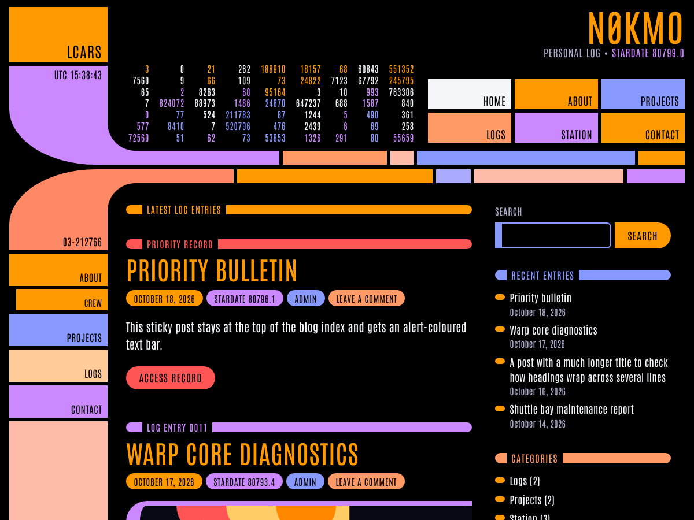

# N0KMO LCARS

An LCARS-inspired WordPress theme for [n0kmo.com](https://n0kmo.com/), styled after the LCARS website templates at [TheLCARS.com](https://www.thelcars.com/).



## Features

- **LCARS frame**: elbow-framed header and content panels joined to segmented colour bars, with a closing elbow at the bottom of the page.
- **Data cascade**: animated columns of numbers in the header. They stop for visitors who prefer reduced motion and hide on phones.
- **Button navigation**: the "Header buttons" menu renders as rectangular LCARS buttons, with a Menu toggle on small screens.
- **Side panels**: the "Side panels" menu becomes the column of panels down the left of the page, with one level of sub-items. Without a menu, the column shows decorative numbered panels.
- **Readouts**: a live UTC clock in the top elbow and TNG-style stardates in the header and on every post.
- **Slashed zero**: Antonio has no slashed zero, so the banner draws one. "N0KMO" stays N0KMO for copying, search and screen readers.
- **Four colour schemes**: Classic, Nemesis Blue, Lower Decks and Red Alert.
- **Optional chirps**: LCARS button sounds synthesised with the Web Audio API, so there are no audio files. Off by default.
- **Block editor support**: editor styles, an LCARS colour palette in `theme.json`, five block styles and three patterns.
- **Elementor support**: the Canvas and Full Width templates, Hide Title, full-width layouts, and the Elementor Pro Theme Builder header, footer, single and archive locations. See [Elementor](#elementor).
- **The usual theme parts**: sidebar and footer widget areas, threaded comments, a full-width template, a custom logo, a translation template, and print and forced-colours styles.

## Installation

1. Build a zip with `bin/build-zip.sh`, or use GitHub's **Code → Download ZIP**. `.gitattributes` keeps development files out of both.
2. In WordPress, go to **Appearance → Themes → Add New → Upload Theme**, upload the zip and activate it.

To install from a clone, put the repository in `wp-content/themes/n0kmo-lcars`.

The theme requires WordPress 6.2 or later and PHP 7.4 or later.

## Setting up

| Where | What |
| --- | --- |
| Appearance → Menus | Assign **Header buttons** (top level only), **Side panels** (two levels) and **Footer** (top level only). |
| Appearance → Widgets | **Sidebar** shows beside content on screens 1100px and wider and below it on narrower ones. **Footer** lays its widgets out in columns. |
| Appearance → Customize → LCARS Interface | Colour scheme, corner panel label, banner text, data cascade, UTC clock, stardates, slashed zeros, sounds, readable body font, footer text (`{year}` is replaced with the current year) and the footer credit. |
| Page attributes → Template | **Full width (no sidebar)** for pages or posts that need the whole content area. |

### Block styles and patterns

| Block | Style | Looks like |
| --- | --- | --- |
| Button | LCARS Panel | Rectangular button with the label in the lower right corner |
| Heading | LCARS Text Bar | Heading set into a rounded bar |
| Separator | LCARS Bar | Full-width segmented bar |
| Group | LCARS Frame | Content wrapped in an elbow bracket |
| List | LCARS List | Pill-shaped bullets |

The **LCARS** pattern category has a status panel, a button panel and a section header.

## Elementor

The theme works with Elementor and Elementor Pro. None of this code runs unless Elementor is active.

| Elementor feature | What happens |
| --- | --- |
| **Elementor Canvas** template | A blank page in the theme's colours and font, without the LCARS frame. |
| **Elementor Full Width** template | The LCARS frame, header and footer stay; the layout gets the whole content area and the sidebar is hidden. |
| Default page template | Elementor layouts use the full content width rather than the 736px reading width. The sidebar stays. |
| **Hide Title** page setting | Hides the text bar and the title. |
| Theme Builder (Pro) | The header, footer, single and archive locations are registered. A header template replaces the LCARS top frame, and a footer template replaces the theme footer inside the frame. Single and archive templates replace the content area and hide the sidebar. |
| Stretched sections | They stretch to the content area instead of the window, so they don't cover the side column. |
| Default colours and fonts | On theme activation, Elementor's default colours and fonts are switched off, unless you already set them, so widgets inherit the LCARS colours and Antonio. You can switch them back on in Elementor's settings. Buttons get the LCARS accent colour unless you style them in Site Settings or in the widget. |

To give Elementor elements an LCARS look, add a class under **Advanced → CSS Classes**:

| Class | Use on | Looks like |
| --- | --- | --- |
| `lcars-heading-bar` | Heading | The heading set into a rounded bar |
| `lcars-panel-button` | Button | Rectangular button with the label in the lower right corner |
| `lcars-frame` | Container, Section or Column | Content wrapped in an elbow bracket |

## How it is built

This is a classic PHP theme. The markup follows the structure and class names of the TheLCARS.com templates (`wrap`, `left-frame-top`, `right-frame-top`, `panel-1`, `banner`, `data-cascade-wrapper`, `bar-panel`, `left-frame`, `right-frame`, `#topBtn`, `hop`). The CSS and JavaScript are an original implementation; no files from TheLCARS.com are included.

Each elbow is a sidebar panel with a large outer radius joined to the first bar of a bar panel. The concave inner curve is drawn with two pseudo-elements: a square in the elbow colour under a quarter circle in the background colour.

```
style.css                      Theme header only
functions.php                  Loads inc/
inc/options.php                Option defaults, colour schemes, n0kmo_lcars_option()
inc/setup.php                  Theme supports, menus, widget areas, editor styles
inc/enqueue.php                Styles, script, font preload, head tags
inc/template-functions.php     Body classes, excerpt and menu fallback hooks
inc/template-tags.php          Stardate, data cascade, panels, entry meta, etc.
inc/customizer.php             LCARS Interface section and selective refresh
inc/block-editor.php           Block styles and the pattern category
inc/elementor.php              Elementor and Elementor Pro compatibility
assets/css/tokens.css          Palette, scheme roles, fonts, frame sizes
assets/css/lcars.css           Frame, navigation, forms, posts, comments, widgets
assets/css/content.css         Typography and block styles (front end and editor)
assets/css/editor.css          Editor-only adjustments
assets/css/elementor.css       Elementor layout fixes and helper classes
assets/js/lcars.js             Clock, stardate, menu toggle, chirps
patterns/                      Block patterns (registered automatically)
template-parts/                Post, page, search and empty-state partials
page-templates/                Full-width template
languages/n0kmo-lcars.pot      Translation template
```

### Customising

- **Colours**: each scheme in `assets/css/tokens.css` only reassigns role variables (`--lcars-panel-1`, `--lcars-elbow-top`, `--lcars-accent-1`, and so on). To make your own scheme, override those variables in a child theme.
- **Frame size**: `--lcars-frame-w`, `--lcars-bar-h`, `--lcars-inner-r` and `--lcars-outer-rx`/`--lcars-outer-ry` control the column width, bar height and elbow curves, with smaller values set for tablets and phones.
- **Filters**: `n0kmo_lcars_has_sidebar` (bool), `n0kmo_lcars_show_entry_header` (bool) and `n0kmo_lcars_content_width` (int, default 736).
- **Child themes**: a child theme's `style.css` loads after the theme's styles.

## Development

- `bin/build-zip.sh [ref]` writes `dist/n0kmo-lcars-<version>.zip` from committed files.
- Regenerate the translation template with WP-CLI: `wp i18n make-pot . languages/n0kmo-lcars.pot`.
- The theme has no build step. Edit the CSS and JS directly.

## Credits and licence

- Licensed under the [GNU GPL v2 or later](LICENSE).
- [Antonio](https://github.com/googlefonts/antonioFont) by The Antonio Project Authors, under the SIL Open Font License 1.1 ([`assets/fonts/antonio/OFL.txt`](assets/fonts/antonio/OFL.txt)).
- The layout and colour naming follow the LCARS templates at [TheLCARS.com](https://www.thelcars.com/). The footer credit linking there can be turned off in the Customizer.

Star Trek and LCARS are trademarks of CBS Studios Inc. This theme is an unofficial fan work and is not affiliated with or endorsed by CBS Studios, Paramount or TheLCARS.com.
